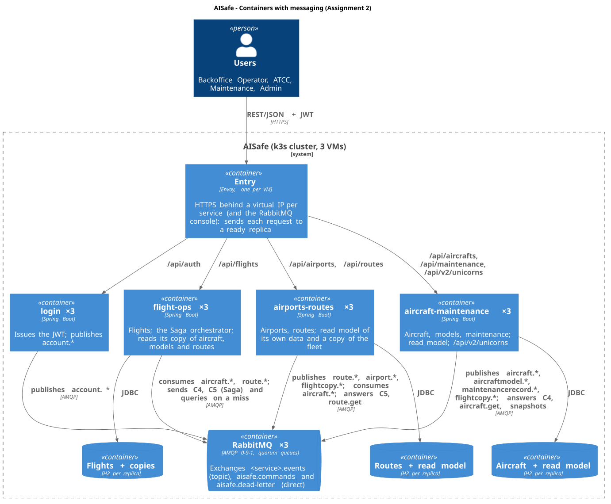
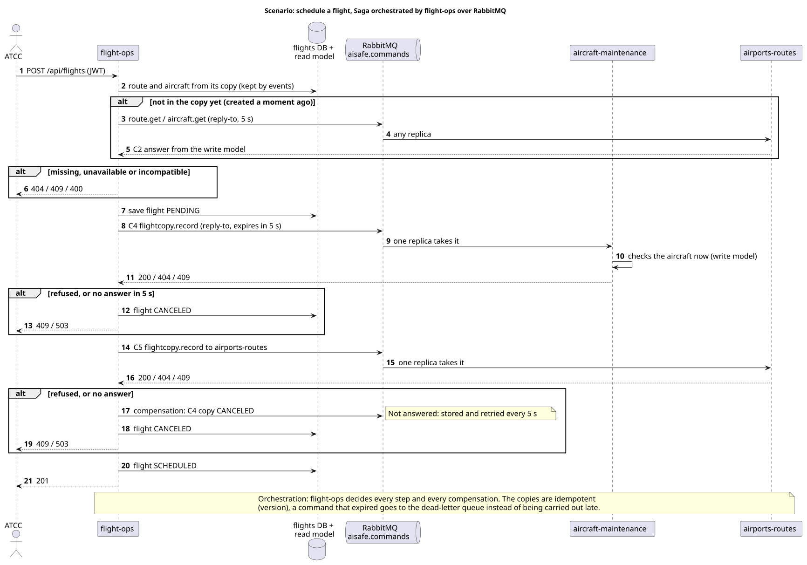
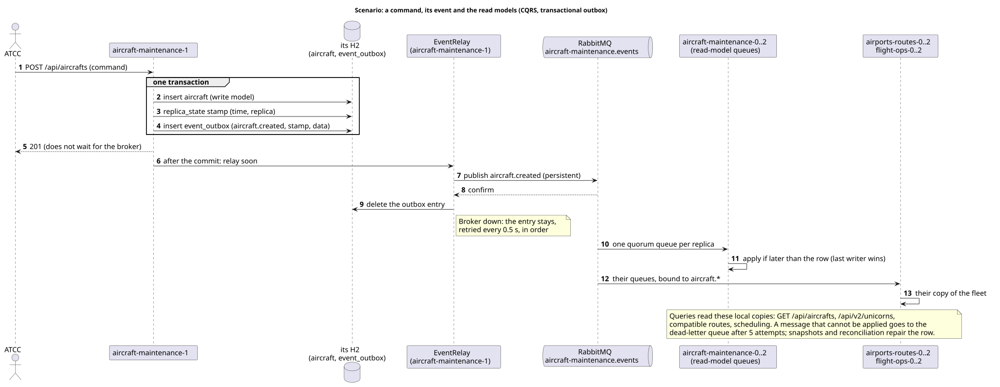

# AISafe - Assignment 2: messaging, CQRS and a database per instance

What Assignment 2 adds to the distributed AISafe of Assignment 1 ([`README.md`](README.md)): the
services talk through RabbitMQ, each service separates its write model from its read model (CQRS),
and every instance keeps its own database. The external API does not change: the same REST routes,
with the same answers, plus `GET /api/v2/unicorns`.

Everything here is switched on by `EVENTS_ENABLED=true` (the k3s deployment sets it). Without it,
each service runs exactly as in Assignment 1 (HTTP between services, no broker), which is how the
unit tests and a single replica on a laptop still run.

## 1. What the assignment asks, and where it is

| Asked                                           | How                                                                                                                                                                                                  | Evidence                                                                                        |
| ----------------------------------------------- | ---------------------------------------------------------------------------------------------------------------------------------------------------------------------------------------------------- | ----------------------------------------------------------------------------------------------- |
| CQRS for the core resources of each service     | Write model: the tables of each entity, partitioned between the replicas (Assignment 1). Read model: a table `read_model` per replica with every entity of every replica, kept by events (section 4) | `X-Query-Side: read-model` on the listings; Postman A2 folder 2                                 |
| AMQP and a message broker between services      | RabbitMQ, three brokers. Events for what changed (publish/subscribe), commands with an answer for the Saga, queries on a miss (section 3)                                                            | Postman A2 folders 1, 3, 4; the RabbitMQ console                                                |
| External endpoints stay HTTP REST               | Unchanged: the same routes and answers as in Assignment 1                                                                                                                                            | The Assignment 1 collection passes against the cluster with events on (86 requests, 199 checks) |
| Database per service (one per instance)         | One H2 per replica, on the replica's own disk (k3s local-path); nothing reads another service's or replica's database (section 5)                                                                    | `X-Data-Node` on a read forwarded to the replica that holds the data (Postman A2 folder 2)      |
| At least two instances of each microservice     | Three of each service, and three RabbitMQ brokers, one per VM                                                                                                                                        | `kubectl -n aisafe get pods -o wide`                                                            |
| Integration tests in Postman                    | `docs/postman/aisafe-a2.postman_collection.json` (33 requests, 84 checks) and the Assignment 1 collection                                                                                            | [`postman/README.md`](postman/README.md)                                                        |
| `/api/v2/unicorns`, and how it fits CQRS        | The mood of every aircraft, a pure query on the read side of aircraft-maintenance (section 8)                                                                                                        | Postman A2 folders 2, 4, 5                                                                      |
| Decisions, consistency, communication, failures | Sections 3 to 7 and 10                                                                                                                                                                               | This document                                                                                   |
| Deployment instructions                         | [`../deploy/README.md`](../deploy/README.md): `deploy/setup.sh` now also installs RabbitMQ and its users                                                                                             |                                                                                                 |

## 2. Containers



| Container | Assignment 2                                                                                                                                                                                                                     |
| --------- | -------------------------------------------------------------------------------------------------------------------------------------------------------------------------------------------------------------------------------- |
| RabbitMQ  | `deploy/manifests/rabbitmq.yaml`: a StatefulSet of three brokers (`rabbitmq:4.3.6-management`), one per VM, clustered by their stable names, with `pause_minority`. The services connect to `rabbitmq-client` (any ready broker) |
| Exchanges | `<service>.events` (topic, one per service), `aisafe.commands` (direct, routed by service name), `aisafe.dead-letter` (direct)                                                                                                   |
| Queues    | quorum queues (replicated on the three brokers): `<service>.read-model.<replica>` (one per replica), `<service>.commands` (one per service, shared by its replicas), `<service>.dead-letter`                                     |
| Console   | `https://192.168.124.29` (management API and console), through the entries over HTTPS like the services                                                                                                                          |

Everything a service needs to use the broker is in `common`
(`aisafe.shared.infrastructure.messaging` and `.readmodel`), so the four services publish, consume
and answer in the same way.

## 3. Communication between services

Three kinds of message, chosen by what the caller needs:

| Kind                        | Used for                                                                                        | Pattern                                                                                      | Example                                          |
| --------------------------- | ----------------------------------------------------------------------------------------------- | -------------------------------------------------------------------------------------------- | ------------------------------------------------ |
| **Event** ("this happened") | every change of an entity, for whoever keeps a copy of it                                       | publish/subscribe on `<service>.events`, routing key `<entity>.<change>`; no answer          | `aircraft.updated` (status UNDER_MAINTENANCE)    |
| **Command** ("do this")     | the steps of the Saga, which must be accepted or refused by the owner at that moment            | request/reply on `aisafe.commands` (`reply-to`, correlation id, expires in 5 s)              | `flightcopy.record` to aircraft-maintenance (C4) |
| **Query** ("tell me")       | a key that the local copy does not have yet (created a moment ago), and the snapshot on startup | request/reply, answered by the owner (from its write model, or its read model for snapshots) | `aircraft.get`, `route.get`, `snapshot`          |

What became of the contracts of Assignment 1:

| #   | Assignment 1 (HTTP)                    | Assignment 2 (RabbitMQ)                                                                                          |
| --- | -------------------------------------- | ---------------------------------------------------------------------------------------------------------------- |
| C1  | `GET /internal/aircrafts/{reg}`        | the `aircraft.*` events, kept in the read model of airports-routes and flight-ops; `aircraft.get` only on a miss |
| C2  | `GET /internal/routes/{o}/{d}`         | the `route.*` events (with the distance), kept by flight-ops; `route.get` on a miss                              |
| C3  | `GET /internal/aircraft-models/{name}` | the `aircraftmodel.*` events (without the image bytes); `aircraftmodel.get` on a miss                            |
| C4  | `PUT /internal/flights/{id}`           | the command `flightcopy.record` to aircraft-maintenance, same use case and same answers (200, 404, 409, 400)     |
| C5  | `PUT /internal/flights/{id}`           | the command `flightcopy.record` to airports-routes                                                               |

The HTTP routes are still there for the mode without events; with events on, nothing calls them.

**Every message carries** the client's correlation id (`x-correlation-id`, written to every log
line), and a command its type and its sender. A command is written to the audit trail like an HTTP
request (`"method": "AMQP"`, `"path": "command:flightcopy.record"`, the sending service as user).

### 3.1 The Saga: orchestration over the broker



Scheduling a flight is still the Saga of Assignment 1 (local transactions with compensations, no
distributed transaction). flight-ops **orchestrates** it: it decides every step and every
compensation, and only the transport changed (commands through the broker instead of `PUT`).

|         | Orchestration (chosen)                                                                                                                                                                    | Choreography                                                                                                                                           |
| ------- | ----------------------------------------------------------------------------------------------------------------------------------------------------------------------------------------- | ------------------------------------------------------------------------------------------------------------------------------------------------------ |
| How     | flight-ops sends C4 and C5 as commands and waits for each answer                                                                                                                          | flight-ops publishes `flight.requested`; aircraft-maintenance and airports-routes react and publish `reserved` / `refused`; each compensates by itself |
| For     | The flow and its compensations are in one place (`ScheduleFlightUseCase`), easy to follow and to test; the client still gets 201 or the reason it was refused, so the API does not change | Looser coupling; the lecture recommends starting with it                                                                                               |
| Against | flight-ops waits for the owners (at most 5 s per step)                                                                                                                                    | The client would get 202 with a PENDING flight and have to ask again (an API change); the flow is spread over three services and harder to debug       |

The lecture describes orchestration as "direct commands to the services, awaiting their answers",
which is what this is. The owner always checks a command against its own data at that moment, so a
copy that is a moment behind can never reserve an aircraft that is no longer available: the owner
refuses it (409) and the Saga compensates. Commands are idempotent (each copy carries the flight's
version), and a command nobody takes within 5 s expires in the queue and goes to the dead-letter
queue instead of being carried out after the sender gave up.

## 4. CQRS



|            | Write side (commands)                                                                                                                     | Read side (queries)                                                                                      |
| ---------- | ----------------------------------------------------------------------------------------------------------------------------------------- | -------------------------------------------------------------------------------------------------------- |
| Where      | the tables of each entity, partitioned: a record on its home replica and the next one, catalogs on all (Assignment 1)                     | table `read_model` of each replica: **every** entity of **every** replica, as the queries need it (JSON) |
| Written by | the use cases (`POST`, `PUT`, `PATCH`, `DELETE`)                                                                                          | only the events, the reconciliation with the peers and the snapshots                                     |
| Read by    | the details of one entity, read before changing it (`GET /api/aircrafts/{reg}`, with its version for `If-Match`); the checks of a command | every listing and report, `/api/v2/unicorns`, and the other services' copies                             |

The use cases did not change: they read through the same ports as in Assignment 1, and only the
implementation behind them does.

| Query port                         | Without events (Assignment 1)          | With events                   |
| ---------------------------------- | -------------------------------------- | ----------------------------- |
| `AircraftAcrossReplicas`           | `GatheredAircraft` (asks the peers)    | `ReadModelAircraft`           |
| `MaintenanceRecordsAcrossReplicas` | `GatheredMaintenanceRecords`           | `ReadModelMaintenanceRecords` |
| `FlightCopiesAcrossReplicas`       | `GatheredFlightCopies` (both services) | `ReadModelFlightCopies`       |
| `RoutesAcrossReplicas`             | `GatheredRoutes`                       | `ReadModelRoutes`             |
| `AirportListings`                  | `LocalAirportListings`                 | `ReadModelAirportListings`    |
| `Fleet` (airports-routes)          | `HttpFleet` (C1, C3)                   | `ReadModelFleet`              |
| `Fleet` (flight-ops)               | `HttpFleet` (C1-C5)                    | `MessagingFleet`              |

What the read model keeps of each entity is a `Projection` (its routing keys, its view, and how to
build it from what the replicas export), or an `ExternalProjection` for another service's entity.

| Service              | Read model: its own entities                                   | Read model: other services' entities           |
| -------------------- | -------------------------------------------------------------- | ---------------------------------------------- |
| aircraft-maintenance | aircraft, aircraft models, maintenance records, flight copies  | -                                              |
| airports-routes      | routes, airports, flight copies                                | aircraft, aircraft models (instead of C1, C3)  |
| flight-ops           | - (its flights are listed across replicas, as in Assignment 1) | aircraft, aircraft models, routes (C1, C2, C3) |
| login                | - (no listings: it only authenticates); publishes `account.*`  | -                                              |

**Why a table in the replica's own database** and not a second database: the two models are
already independent (different tables, different writers, different shape), and a second H2 per
replica would add nothing but another file. A different store for reading (e.g. a document
database) would only pay off with heavier queries than the project has.

**Why not event sourcing:** the write model keeps the current state, as in Assignment 1, and the
events are notifications of changes, not the source of truth. Event sourcing would give a full
history and replay, at the cost of rebuilding every aggregate from its events; the audit trail and
the route history already cover what the project needs to know about the past.

## 5. Database per instance

Each replica of each service has its own H2 database on its own disk
(`jdbc:h2:file:/data/<service>`, a k3s local-path volume): twelve databases for the twelve replicas.
No service and no replica reads another one's database; they exchange data only through RabbitMQ
(between services) and the peer API of Assignment 1 (between replicas of a service). Visible in the
Postman A2 collection: an aircraft created on `aircraft-maintenance-1` is held by `-1` and `-2`;
`aircraft-maintenance-0` answers a read of it with the data of a replica that holds it
(`X-Data-Node`), while its read model already lists it.

## 6. Consistency model

- **Eventual consistency between services and in the read models.** A change is answered by one
  replica; its event reaches every read model shortly after (milliseconds on the cluster). The
  write model of each entity is as in Assignment 1.
- **No event is lost: transactional outbox.** The event is written to `event_outbox` in the
  transaction of the change; `EventRelay` sends it right after the commit and every 0.5 s, and removes
  it only when the broker confirms it (publisher confirms). With the broker down, writes keep working
  and the events leave, in order, when it is back.
- **At least once, idempotent consumers.** An event may arrive twice or out of order: every row of
  the read model keeps the stamp of the change it shows (time and replica, the same stamp the
  replication gives it), and a change is applied only if it is later (last writer wins, inside the
  `UPDATE` itself, so two writers of the same row cannot both pass the check). A deletion leaves the
  row marked deleted, so an older event cannot bring it back.
- **Read your own writes across services.** A key the local copy does not have yet is asked to the
  owner (`aircraft.get`, `route.get`): an aircraft created a moment ago is never taken as
  nonexistent. Measured on the cluster before this: flight-ops was asked to schedule a flight 20 ms
  after the aircraft was created, before its event arrived, and answered 404.
- **What repairs a copy:** the reconciliation with the peers for a service's own entities (on startup,
  before the replica is ready, and every 60 s), and the snapshots for other services' entities (on
  startup, every 15 s until the owner answers with data, then every 5 minutes).
- **Commands are checked by the owner at that moment** (section 3.1): the copies are used to answer
  queries and to refuse early, never to accept a Saga step.

## 7. Fault tolerance

| Failure                                  | Behaviour                                                                                                                                                                                                                                                                  |
| ---------------------------------------- | -------------------------------------------------------------------------------------------------------------------------------------------------------------------------------------------------------------------------------------------------------------------------- |
| One broker down (pod or VM)              | The queues are quorum queues on three brokers: they keep working with two; the services notice a dead broker by the heartbeat (10 s) and reconnect to another one (`rabbitmq-client`)                                                                                      |
| The whole broker down                    | Writes keep working; their events wait in each replica's outbox. Listings answer from the read models (maybe behind). Scheduling a flight fails with 503 ("try again"), as when an owner was down in Assignment 1                                                          |
| A replica down                           | Its read-model queue keeps the events for it (durable); when it is back it applies them and reconciles before it is ready                                                                                                                                                  |
| A new replica, or the first deployment   | It declares its queue first, then asks the owners for a snapshot of what it keeps                                                                                                                                                                                          |
| A message that cannot be handled         | After 5 deliveries it goes to the service's dead-letter queue (`x-delivery-limit`); the read model is repaired by the reconciliation or the next snapshot                                                                                                                  |
| A command nobody takes                   | Expires in 5 s and goes to the dead-letter queue. An idempotent command (C4, C5, the queries) is sent once more, and the second one goes to another replica of the owner; if that one does not answer either, the sender gets "unavailable" (503) and the Saga compensates |
| A replica of the owner on a VM that dies | It holds at most one command (prefetch 1) until its connection is declared dead (heartbeat 10 s); the other commands go to the replicas that are alive                                                                                                                     |
| An owner down                            | Its data is still read from the copies; a key not in the copy, or a Saga step, gets 503                                                                                                                                                                                    |
| A network partition between brokers      | `pause_minority`: a broker cut off from the other two stops instead of going on alone (no split brain)                                                                                                                                                                     |

**Measured** with `deploy/manifests/failure-test.sh` on the reference cluster, with events on:
see section 9 (a broker killed: 0 bad requests; a VM lost: 4 and 1 in more than 4000).

## 8. `/api/v2/unicorns` and CQRS

`GET /api/v2/unicorns` (aircraft-maintenance, any signed-in role) gives the mood of every aircraft:

| Mood      | When                                            |
| --------- | ----------------------------------------------- |
| `SLEEPY`  | inactive                                        |
| `GRUMPY`  | under maintenance, or a maintenance in progress |
| `EXCITED` | in flight                                       |
| `ANXIOUS` | available, with a maintenance planned           |
| `HAPPY`   | available, nothing planned                      |

```json
[
  {
    "registrationNumber": "CS-TKA",
    "model": "Airbus A320neo",
    "status": "AVAILABLE",
    "mood": "HAPPY",
    "reason": "Ready to fly"
  }
]
```

It is a query and nothing else: `ViewAircraftMoodsUseCase` reads the query side (the fleet and the
maintenance records of the read model) and never the write model, nor changes anything. So it scales
with the read model (any replica answers it locally, with the aircraft of every replica), is never
slowed by the writes, and is eventually consistent: an aircraft put under maintenance turns
`GRUMPY` as soon as its event reaches the replica (Postman A2 folder 4). The header `X-Query-Side`
says which side answered (`read-model`, or `peers` without events). `v2` because it is the first
route of the new version of the API; the routes of version 1 did not change.

## 9. Tests

| Test                                  | Result                                                                                                                                               |
| ------------------------------------- | ---------------------------------------------------------------------------------------------------------------------------------------------------- |
| Unit and integration (`./mvnw test`)  | 1258 tests (common 136, aircraft-maintenance 485, airports-routes 435, flight-ops 144, login 58)                                                     |
| Postman, Assignment 2                 | 33 requests, 84 checks, all passing on the cluster (three runs in a row)                                                                             |
| Postman, Assignment 1, with events on | 86 requests, 199 checks, all passing: the external API did not change                                                                                |
| Broker down (local, 3 replicas)       | a route created with RabbitMQ stopped (201), its event kept in the outbox and delivered when the broker came back, then listed by the other replicas |
| Failure test (`failure-test.sh`)      | below                                                                                                                                                |

Measured on 2026-11-04 and 2026-11-05 on the reference cluster, with events on (RabbitMQ, CQRS,
the Saga over the broker) and 14 kinds of request running at the same time (as in Assignment 1):

| Scenario                                      | Back to normal | Requests | Bad | What the bad ones were                                                                                       | Slowest |
| --------------------------------------------- | -------------- | -------- | --- | ------------------------------------------------------------------------------------------------------------ | ------- |
| replica-crash (aircraft-maintenance-1)        | 34 s           | 1717     | 0   | -                                                                                                            | 1.0 s   |
| routes-crash (airports-routes-1)              | 36 s           | 1780     | 1   | a route re-created right after its deletion got 409 (known since Assignment 1)                               | 2.2 s   |
| flight-ops-crash (flight-ops-1)               | 34 s           | 1818     | 0   | -                                                                                                            | 1.3 s   |
| login-crash                                   | 25 s           | 1505     | 0   | -                                                                                                            | 0.8 s   |
| **rabbitmq-crash** (a broker killed)          | 13 s           | 750      | 0   | -                                                                                                            | 1.6 s   |
| deploy (every service, one replica at a time) | 277 s          | 8642     | 1   | a route re-created right after its deletion got 409                                                          | 3.9 s   |
| node-off (a VM loses power)                   | 113 s          | 4070     | 4   | 3 flight schedulings got 503 ("try again") between 15 s and 38 s; 1 route creation had no answer within 15 s | 15 s    |
| node-freeze (a VM's kernel stops)             | 126 s          | 4375     | 1   | 1 delete had no answer within 15 s                                                                           | 15 s    |

Compared with Assignment 1 (`README.md`, section 9), losing a VM went from 174 bad requests to 4: the
listings are answered by each replica's read model, so they are never partial.

**What the first run taught.** On 2026-11-04, before the last fix, the broker and VM scenarios gave
1 (rabbitmq-crash), 13 (node-off) and 19 (node-freeze) bad requests, nearly all flight schedulings
answered 503 for about two minutes. The commands are shared round-robin by the owner's replicas, and
the replica on the dead VM had already been handed a batch of them (RabbitMQ's default prefetch)
that waited until its connection was declared dead (60 s heartbeat). With a 10 s heartbeat,
prefetch 1 and one more attempt for the idempotent commands (section 7), the same scenarios gave 0,
4 and 1.

## 10. Security

| Measure                       | How                                                                                                                                                                                                                                                                                                                                                                             |
| ----------------------------- | ------------------------------------------------------------------------------------------------------------------------------------------------------------------------------------------------------------------------------------------------------------------------------------------------------------------------------------------------------------------------------- |
| One RabbitMQ user per service | Made by `deploy/setup.sh` inside a broker, with a random password from the Secret `aisafe-rabbitmq` (never on a command line outside the broker, never in git). Each one may only declare and use its own exchange and queues, the shared exchanges of commands and dead letters, and the events of the services it reads (e.g. airports-routes cannot publish aircraft events) |
| Test user                     | `postman`: its own queues (`postman.*`), bound to the events of every service; it cannot publish events nor send commands                                                                                                                                                                                                                                                       |
| Management                    | console and API only through the entries over HTTPS (`https://192.168.124.29`, same certificate as the services); the AMQP port is reachable only inside the cluster                                                                                                                                                                                                            |
| Brokers                       | clustered with an Erlang cookie from the same Secret; no `guest` user                                                                                                                                                                                                                                                                                                           |
| Events                        | never carry secrets: `account.*` carries the user name and role, never the password hash; aircraft models without their image bytes                                                                                                                                                                                                                                             |
| Audit                         | every command handled is one line in the audit trail, like the HTTP requests                                                                                                                                                                                                                                                                                                    |

## 11. Decisions and alternatives

| Decision                                               | Why                                                                                                             | Alternative left out                                                                     |
| ------------------------------------------------------ | --------------------------------------------------------------------------------------------------------------- | ---------------------------------------------------------------------------------------- |
| RabbitMQ (AMQP)                                        | The assignment asks AMQP; topic exchanges for events, request/reply for commands, quorum queues for replication | Kafka: a log with replay, but not AMQP and heavier for three 4 GB VMs                    |
| Three brokers, quorum queues                           | Survives a VM like the services do                                                                              | One broker: simpler, but a single point of failure                                       |
| Transactional outbox for events                        | No event lost when the broker is down or the replica stops after the commit                                     | Publishing after the commit (lost with the broker down, repaired only by reconciliation) |
| Events carry the entity (event-carried state transfer) | The consumers keep a copy without asking back                                                                   | Thin events ("aircraft X changed") and a call to the owner for each one                  |
| Read model as a table per replica, with every entity   | Any replica answers every listing alone, also with the other replicas down                                      | A shared read database (a shared database between instances)                             |
| Saga by orchestration over the broker                  | Same flow and same API; the owner decides (section 3.1)                                                         | Choreography (202 and a PENDING flight)                                                  |
| Local copy first, owner asked on a miss                | Fast and independent of the owner in the normal case; never a false 404 right after a creation                  | Only the copy (false 404s for a moment), or always asking (the coupling of Assignment 1) |
| Snapshots on startup through the broker                | A new replica gets everything from the owners without HTTP between services                                     | Reading the other service's internal API, or replaying a log                             |
| `EVENTS_ENABLED` switch                                | Assignment 1 still runs and its tests still pass; the broker is optional for development                        | Removing the HTTP contracts                                                              |

## 12. Known limitations

- **The read models can be behind**, by milliseconds normally, longer with the broker down; the
  details of an entity (read before changing it) always come from the write model.
- **Events are not a history**: the read model shows the latest state; past states are in the audit
  trail and the route history only.
- **AMQP inside the cluster is not encrypted** (as HTTP inside the cluster in Assignment 1); the
  passwords protect who can publish what, not the traffic.
- **A read-model queue of a replica removed for good** keeps receiving events until it is deleted
  by hand (the StatefulSets always use the same three names, so this does not happen in normal use).
- **Last writer wins** still depends on the clocks of the VMs (NTP), as in Assignment 1.
- **A snapshot is one message with every row** of an entity (about 9000 aircraft on the reference
  cluster after the test runs): fine at this size, it would need pages for much more.
